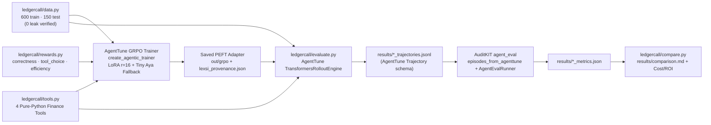

# LedgerCall

**One-line claim:** Agentic GRPO fine-tuning with AgentTune and AuditKIT teaches a compact ~3B gated model (`CohereLabs/tiny-aya-global`) to reliably invoke and compose deterministic finance tools instead of hallucinating arithmetic, without inflating trajectory length.

---

## Tracks & Problem Statements

- **Track:** Track 3 — Agentic Fine-Tuning
- **Primary Problem Statement:** Reliable tool calling
- **Secondary Problem Statement:** Efficient trajectories

---

## Abstract

Small open-weight language models (~3B parameters) are attractive for enterprise financial operations because they can run inside a private VPC on inexpensive commodity GPUs with predictable latency and strict data governance. However, out of the box, compact checkpoints—especially models whose default chat templates do not natively render OpenAI-style `tools` schemas, such as `CohereLabs/tiny-aya-global`—frequently attempt mental arithmetic on multi-digit interest, loan amortization, percentage delta, or foreign-exchange queries, emit malformed JSON tool payloads, or call tools in the wrong order on two-step workflows.

**LedgerCall** addresses this reliability gap end-to-end using **AgentTune** and **AuditKIT**. First, we construct a deterministic, seeded generator (`ledgercall/data.py`) covering four pure-Python financial calculators (`convert_currency`, `compound_interest`, `percent_change`, `loan_payment`) across both single-tool lookups and two-step sequential compositions (600 training tasks, 150 held-out test tasks, verified zero prompt overlap). Second, we leverage AgentTune's `create_agentic_trainer(algorithm="grpo")` with LoRA (`r=16`, `all-linear`) and AgentTune's built-in Tiny Aya tool-calling fallback—which injects tool JSON schemas into the system prompt and folds tool observations back into user turns so multi-step rollouts execute cleanly on a single 16 GB T4 (`fp16`) or 24 GB L4 (`bf16`) GPU without vLLM. Our three-component GRPO reward (`correctness`, `tool_choice`, and a non-positive `efficiency` excess-call penalty designed to prevent zero-call reward hacking) reinforces accurate numeric answers (`≤1%` relative tolerance wrapped in `*...*`), ordered tool selection, and minimal step counts. Finally, every evaluation rollout writes portable `trajectories.jsonl` traces consumed directly by `auditkit.agent_eval.episodes_from_agenttune` and `AgentEvalRunner` to verify task outcomes alongside `tool_call_f1_name`, `tool_call_validity`, `redundant_tool_calls`, and `agent_loop_detection`.

---

## Headline Result (Before → After)

- **Task Success (`≤1%` numeric tolerance):** `TODO_BASE_SUCCESS%` → **`TODO_TUNED_SUCCESS%`** (`+TODO_DELTA pp`)
- **Ordered Tool Call Accuracy:** `TODO_BASE_TOOL_ACC%` → **`TODO_TUNED_TOOL_ACC%`** (`+TODO_TOOL_DELTA pp`)
- **Malformed / Failed Tool Call Rate:** `TODO_BASE_MALFORMED%` → **`TODO_TUNED_MALFORMED%`** (`-TODO_MALFORMED_DELTA pp`)

---

## Base Model & Method

`CohereLabs/tiny-aya-global` (~3B, gated) fine-tuned with **Group Relative Policy Optimization (GRPO)** + **LoRA (`r=16`, `all-linear`)** over multi-turn tool-calling rollouts via **AgentTune** (`backend="trl"`, `use_vllm=False`) and audited offline with **AuditKIT** (`auditkit.agent_eval`).

---

## For Judges: One-Minute Box

> **What problem does LedgerCall solve?**
> Financial ops assistants cannot "approximate" compound interest, loan amortization, or FX conversions in weights—they must call deterministic calculators reliably and stop without looping.
>
> **How do Lexsi kits power this submission?**
> - **AgentTune:** Drives multi-step tool rollouts on `CohereLabs/tiny-aya-global` (via its automatic `tools_fallback_prompt` + user-turn tool-result folding), trains a LoRA policy with `create_agentic_trainer(algorithm="grpo")`, and exports `trajectories.jsonl` + `lexsi_provenance.json`.
> - **AuditKIT:** Imports AgentTune's `trajectories.jsonl` zero-copy via `episodes_from_agenttune` and scores verified numeric outcomes (`CustomPredicate`) plus `tool_call_f1_name`, `tool_call_validity`, `redundant_tool_calls`, and `agent_loop_detection`.
>
> **Key delta:** `TODO_BASE_SUCCESS%` → `TODO_TUNED_SUCCESS%` task success on held-out test set (`--limit 100` / full `150`), fitting on a single free Kaggle T4 (16 GB).
>
> **Quick check:** `python -m ledgercall.data --out data/ && python -m pytest -q tests/` (runs on CPU in <2s, no GPU/network needed).

---

## Problem & Why It Matters

Finance operations assistants (treasury reconciliation, invoice FX conversion, loan quote checks, variance reporting) face zero tolerance for silent numeric hallucination. A 3B model answering `$14,820.00` instead of `$15,192.44` on a multi-year compounded balance—or applying a memorized, stale exchange rate instead of calling the desk's authoritative rate table—creates downstream accounting errors that are hard for human reviewers to spot inside fluent prose. Teaching compact models to **always delegate arithmetic to deterministic tools**, pass intermediate tool outputs accurately into downstream tools, and emit machine-parseable final numbers makes small self-hosted models viable for regulated financial workflows.

---

## Threat Model

1. **Silent Arithmetic Hallucination:** The model skips tool invocation and guesses a plausible-looking number that fails accounting tolerance.
2. **Wrong Tool / Reversed Composition:** On 2-step tasks (e.g., compound interest followed by FX conversion), the model calls tools in reverse order or substitutes an unrelated calculator.
3. **Malformed Tool Payloads:** Models without native tool-use chat templates emit broken JSON, hallucinated tool names, or wrong parameter keys.
4. **Runaway / Redundant Trajectories:** Under RL, poorly shaped rewards can incentivize either **tool-skipping** (0 calls to collect an efficiency bonus) or **repetitive tool loops** that inflate latency and compute cost.

---

## Lexsi Kits Used & Architecture

### 1. AgentTune
- **`create_agentic_trainer(algorithm="grpo")`:** Trains the LoRA policy end-to-end on TRL with multi-turn tool execution inside the generation loop.
- **Standalone Rollout Engine (`create_rollout_engine` + `create_rollout_fn`):** Runs deterministic (`do_sample=False`) multi-turn evaluation rollouts on the `transformers` backend (`use_vllm=False`).
- **Tiny Aya Tool-Calling Fallback:** Because `CohereLabs/tiny-aya-global`'s chat template ignores `tools=` and renders `tool` turns empty, AgentTune automatically injects JSON tool schemas via `DEFAULT_TOOLS_FALLBACK_PROMPT` (`[{"tool_name": ..., "parameters": {...}}]`) and folds tool outputs into user turns via `DEFAULT_TOOL_RESULT_FORMAT`.
- **Portable Artifact Export:** Writes `trajectories.jsonl` (`Trajectory.to_dict()`) and `lexsi_provenance.json`.

### 2. AuditKIT
- **`auditkit.agent_eval.episodes_from_agenttune`:** Reads AgentTune's `trajectories.jsonl` directly into typed `AgentEpisode` traces with honest coverage metadata (`tool_call_names`, `tool_call_arguments`, `tool_results`).
- **`AgentEvalRunner` + `AgentEvalSpec` (recorded mode):** Evaluates episodes offline against an authoritative `CustomPredicate` numeric oracle (`≤1%` relative tolerance on `*...*`) and computes diagnostic scorers: `tool_call_f1_name`, `tool_call_validity`, `redundant_tool_calls`, and `agent_loop_detection`.

### Connection Diagram



---

## Models & Licenses

| Component | Identifier | License & Access Notes |
| :--- | :--- | :--- |
| **Base Model** | [`CohereLabs/tiny-aya-global`](https://huggingface.co/CohereLabs/tiny-aya-global) | **Gated (~3B)**; **CC-BY-NC** (non-commercial) per upstream documentation — **check model card** and accept terms on Hugging Face Hub before downloading. |
| **Fine-Tuning Kit** | `AgentTune` (`Lexsi-Labs/AgentTune`) | Lexsi Labs Source Available License (LSAL v1.1, non-commercial research/evaluation). |
| **Evaluation Kit** | `AuditKIT` (`Lexsi-Labs/AuditKIT`) | Lexsi Labs Source Available License (LSAL v1.2, non-commercial research/evaluation). |
| **LedgerCall Code & Synthetic Data** | This repository | MIT License (code & synthetic prompts; trained adapter inherits base model restrictions — check model card). |

---

## Datasets

Generated deterministically by [`ledgercall/data.py`](ledgercall/data.py) (`seed=42`):
- **Splits:** `600` train (`data/train.jsonl`) and `150` test (`data/test.jsonl`), balanced evenly across **8 task families**:
  - **4 Single-tool tasks (`50%`):** `single_convert_currency`, `single_compound_interest`, `single_percent_change`, `single_loan_payment`.
  - **4 Two-step sequential tasks (`50%`):**
    - `two_step_ci_fx`: `compound_interest` → `convert_currency`
    - `two_step_loan_fx`: `loan_payment` → `convert_currency`
    - `two_step_fx_pct`: `convert_currency` → `percent_change`
    - `two_step_ci_pct`: `compound_interest` → `percent_change`
- **Row schema:** `prompt` (system + user chat messages instructing final output wrapped as `*123.45*`), `answer` (2-decimal string), `expected_tools` (ordered list of tool names), `task_type`, `language` (`"en"`).
- **Leakage Verification:** `check_leakage(train_rows, test_rows)` enforces exact normalized user-prompt disjointness (`leak_overlap_count = 0` recorded in `data/stats.json`).

---

## Metrics & Why They Were Chosen

| Metric | Source | Direction | Why It Matters / Guardrail Role |
| :--- | :--- | :---: | :--- |
| `task_success` | LedgerCall + AuditKIT `CustomPredicate` | **↑ Higher** | Headline accuracy: final `*...*` number within `1%` relative tolerance of ground truth. |
| `tool_call_accuracy` | LedgerCall | **↑ Higher** | Fraction of `expected_tools` called in the exact required causal order. |
| `tool_call_f1_name` | AuditKIT `agent_eval` | **↑ Higher** | Precision/recall harmonic mean over tool names against reference turns. |
| `tool_call_validity` | AuditKIT `agent_eval` | **↑ Higher** | **Must not degrade:** verifies called tools belong to the allowed schema. |
| `malformed_call_rate` | LedgerCall | **↓ Lower** | **Must not get worse:** catches broken JSON, hallucinated tool names, and execution errors. |
| `redundant_tool_calls` | AuditKIT `agent_eval` | **↓ Lower** | **Must not get worse:** detects duplicate identical `(tool, args)` invocations. |
| `agent_loop_detection` | AuditKIT `agent_eval` | **↑ Higher** | **Must not get worse:** `1.0` indicates zero repetitive tool-call loops. |
| `avg_tool_calls` & `avg_latency_s` | LedgerCall | **↓ Lower / Bounded** | **Must not blow up:** ensures reliability gains come from clean trajectories (~1.5 calls/task average), not brute-force retries. |

---

## Method & Hyperparameters

- **Algorithm:** Agentic GRPO via `agenttune.core.backend_factory.create_agentic_trainer(algorithm="grpo", backend="trl")`.
- **Composite Reward (`weights=[1.0, 0.5, 0.5]`):**
  1. `correctness`: `1.0` if final `*...*` numeric answer is within `0.01` (`1%`) relative tolerance, else `0.0`.
  2. `tool_choice`: ordered subsequence recall in `[0.0, 1.0]` over `expected_tools`.
  3. `efficiency`: `0.0` when `actual_calls <= len(expected_tools)` and `-0.25` per extra call (capped at `-1.0`). *Safety note:* keeping efficiency non-positive (`≤ 0.0`) eliminates the classic reward-hacking shortcut where an untrained policy emits zero tool calls just to collect a positive efficiency bonus.
- **Adapter:** LoRA `r=16`, `lora_alpha=32`, `lora_dropout=0.05`, `target_modules="all-linear"`, `task_type="CAUSAL_LM"`.
- **Single-GPU Budget Fit (16 GB T4 / 24 GB L4):**
  - `use_vllm=False`, `gradient_checkpointing=True`
  - Automatic precision detection (`ledgercall/train.py:detect_precision`): **`fp16=True` on NVIDIA T4** (Turing SM 7.5 lacks native `bf16`) and **`bf16=True` on L4 / Ampere+**.
  - `max_steps=150`, `num_generations=4`, `per_device_train_batch_size=4`, `gradient_accumulation_steps=2`, `max_steps_per_turn=4`, `max_completion_length=384`, `learning_rate=5e-5`.

---

## Results

> **TODO:** Populate after running `notebooks/ledgercall_kaggle.ipynb` (or CLI commands below) on T4/L4 GPU and copying `results/comparison.md`.

| Metric | Direction | Base (`tiny-aya-global`) | GRPO-Tuned (`out/grpo`) | Delta |
| :--- | :---: | ---: | ---: | ---: |
| Task Success (`≤1%` tol) | ↑ | `TODO` | `TODO` | `TODO` |
| Tool Call Accuracy (ordered) | ↑ | `TODO` | `TODO` | `TODO` |
| Exact Tool Sequence Match | ↑ | `TODO` | `TODO` | `TODO` |
| Malformed / Failed Call Rate | ↓ | `TODO` | `TODO` | `TODO` |
| Avg Tool Calls / Task | ↓ | `TODO` | `TODO` | `TODO` |
| Avg Latency / Task (s) | ↓ | `TODO` | `TODO` | `TODO` |
| AuditKIT Verified Success | ↑ | `TODO` | `TODO` | `TODO` |
| AuditKIT Tool Call F1 (name) | ↑ | `TODO` | `TODO` | `TODO` |
| AuditKIT Tool Call Validity | ↑ | `TODO` | `TODO` | `TODO` |
| AuditKIT Redundant Tool Calls | ↓ | `TODO` | `TODO` | `TODO` |
| AuditKIT No-Loop Score | ↑ | `TODO` | `TODO` | `TODO` |

---

## Cost & ROI

`ledgercall/evaluate.py` measures wall-clock latency (`avg_latency_s`) and generation throughput (`tokens_per_sec`), and `ledgercall/compare.py` computes unit economics per **1,000 tasks**:
- **Self-Hosted T4 Equivalent (`$0.35/hr` spot/cloud rate):** `Cost / 1k tasks = (avg_latency_s × 1000 / 3600) × $0.35` → **`TODO_T4_COST_PER_1K`** at **`TODO_TOK_PER_SEC` tok/s** (sequential `batch=1`; continuous batching reduces unit cost further while keeping sensitive financial ledger data inside a private VPC).
- **Hosted Frontier-Mini Baseline (*ASSUMPTION placeholder to verify/fill in*):** Compared against a GPT-4o-mini list-price placeholder assumed at `$0.15 / 1M` input tokens and `$0.60 / 1M` output tokens (~650 prompt tokens + ~120 output tokens across multi-turn tool calls ≈ `$0.1695 / 1k tasks` — *verify current provider pricing and exact token counts at run time*).

---

## Limitations

1. **English-only synthetic phrasings:** Although `tiny-aya-global` is multilingual, v0.1 evaluates English (`language="en"`) templates so tool-calling mechanics can be isolated cleanly within the 12-hour sprint.
2. **Static FX table & 4 tools:** `convert_currency` uses a fixed 5-currency table (`USD`, `EUR`, `GBP`, `JPY`, `INR`) rather than live market feeds or noisy API error states.
3. **No adversarial prompt-injection evaluation yet:** Tool-output prompt injection and permission boundary probes are not yet included in the training/eval loop.

---

## With More Compute / Credits

1. **Multilingual Finance Tool Calling (`hi`, `es`, `fr`, `ja`, `de`):** Extend `ledgercall/data.py` across Tiny Aya's multilingual strengths to test cross-lingual tool-argument extraction; *expected:* `+20–35 pp` multi-step accuracy gain in non-English locales where zero-shot JSON tool formatting degrades sharpest.
2. **3–4 Step Ledger Reconciliation + Irrelevance Refusal Cases:** Add multi-invoice aggregation and "no-tool-applicable" abstention tasks scored with AuditKIT's empty-reference `reference_turns=[]` support; *expected:* lower false-positive tool invocation on non-calculable policy questions.
3. **Adversarial Tool-Output Red-Teaming:** Integrate `auditkit.redteam.RedTeamRunner` + `tool_permission` scorers to harden the adapter against prompt injections embedded in vendor invoice descriptions.
4. **Trajectory Distillation (`create_distill_trainer`):** Warm-start SFT from verified high-reward trajectories before GRPO (`500+` steps on L4/A100); *expected:* faster convergence and `<2%` malformed call rate.

---

## Artifacts

- **Hugging Face Model Collection:** `TODO: https://huggingface.co/collections/<HF_USER>/ledgercall-models-...`
- **Hugging Face Dataset Collection:** `TODO: https://huggingface.co/collections/<HF_USER>/ledgercall-datasets-...`
- **Trained LoRA Adapter Repo:** `TODO: https://huggingface.co/<HF_USER>/ledgercall-tiny-aya-grpo`
- **Dataset, Trajectories & Metrics Repo:** `TODO: https://huggingface.co/datasets/<HF_USER>/ledgercall-finance-toolbench`
- **GitHub Repository:** `TODO: https://github.com/<GITHUB_USER>/ledgercall`
- **End-to-End Kaggle Notebook:** [`notebooks/ledgercall_kaggle.ipynb`](notebooks/ledgercall_kaggle.ipynb)

---

## Reproduction

```bash
# 1. Install dependencies (GPU machine: Kaggle T4 / Colab T4 or L4)
pip install "git+https://github.com/Lexsi-Labs/AgentTune" "auditkit[transformers]" peft datasets huggingface_hub pytest

# 2. Authenticate with Hugging Face (after accepting CohereLabs/tiny-aya-global license)
export HF_TOKEN="<your_hf_token>"
export HF_USER="<your_hf_username>"

# 3. Generate deterministic train (600) & test (150) splits + run CPU unit tests
python -m ledgercall.data --out data/
python -m pytest -q tests/

# 4. Evaluate base model (--limit 100 for fast hackathon run, or omit --limit for all 150)
python -m ledgercall.evaluate --model CohereLabs/tiny-aya-global --data data/test.jsonl --tag base --limit 100

# 5. Train GRPO LoRA adapter (auto-selects fp16 on T4, bf16 on L4)
python -m ledgercall.train --train_file data/train.jsonl --output_dir out/grpo --max_steps 150

# 6. Evaluate GRPO-tuned adapter
python -m ledgercall.evaluate --model out/grpo --data data/test.jsonl --tag tuned --limit 100

# 7. Generate before/after Markdown comparison & Cost/ROI table
python -m ledgercall.compare --base results/base_metrics.json --tuned results/tuned_metrics.json --out results/comparison.md

# 8. Optional: push adapter, dataset, trajectories, and public HF Collections
python scripts/push_to_hub.py --adapter-dir out/grpo --data-dir data --results-dir results
```

---

## Declaration of Work Outside Hackathon

None — all project code, tool definitions, synthetic data generators, reward functions, evaluation harnesses, notebook cells, and write-up materials were built from scratch during the hackathon on **November 15, 2026** (using the organizer-provided upstream `AgentTune` and `AuditKIT` libraries).

---

## LLM Usage Statement

Substantial AI assistance was used for scaffolding the repository layout, pure-Python tool/generator boilerplate, defensive reward parsing, unit test suite, Kaggle notebook structure, and README skeleton. Experimental execution, hyperparameter selection for T4 memory constraints, and final metric verification remain under human review.

---

## Changelog

- **2026-11-15 (`v0.1.0`):**
  - Added 4 deterministic finance tools (`ledgercall/tools.py`) with Google-style docstrings for AgentTune schema extraction.
  - Added seeded 600/150 single-tool and 2-step task generator with zero-overlap leak verification (`ledgercall/data.py`).
  - Added defensive TRL/AgentTune GRPO rewards (`correctness`, `tool_choice`, `efficiency`) (`ledgercall/rewards.py`).
  - Integrated AgentTune `TransformersRolloutEngine` + Tiny Aya fallback with AuditKIT `agent_eval` scoring (`ledgercall/evaluate.py`).
  - Added T4 (`fp16`) / L4 (`bf16`) GRPO LoRA training script (`ledgercall/train.py`), delta + Cost/ROI comparator (`ledgercall/compare.py`), Hub publisher (`scripts/push_to_hub.py`), Kaggle notebook (`notebooks/ledgercall_kaggle.ipynb`), and CPU `pytest` suite (`tests/test_core.py`).
