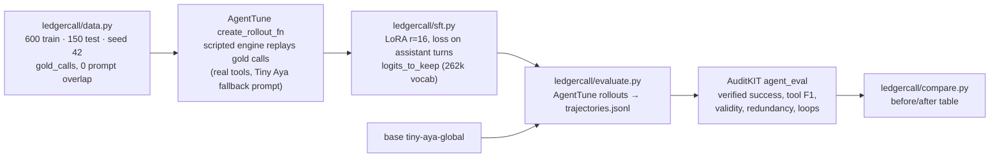

# LedgerCall

**Teaching a 3.35B open-weights model to call finance tools instead of guessing numbers.**
Cohere `tiny-aya-global` + LoRA, trained with AgentTune-rendered trajectory SFT and audited with AuditKIT on held-out multi-step finance tasks.

- **Track 3: Agentic Fine-tuning** — problem statements **Reliable tool calling** and **Efficient trajectories**
- Model: [frankzhu94/ledgercall-tiny-aya-sft](https://huggingface.co/frankzhu94/ledgercall-tiny-aya-sft) · Dataset: [frankzhu94/ledgercall-finance-toolbench](https://huggingface.co/datasets/frankzhu94/ledgercall-finance-toolbench) · Demo: [Space](https://huggingface.co/spaces/frankzhu94/ledgercall-demo) · Collection: _(collection link added at publish)_ · Code: _(GitHub link added at publish)_

## Headline result (100 held-out test tasks, same prompts, greedy decoding, T4)

| Metric | Direction | Base tiny-aya-global | LedgerCall (SFT LoRA) | Change |
| :--- | :---: | ---: | ---: | ---: |
| Task Success (numeric ≤1% tol) | ↑ higher | 0.0% | 100.0% | **+100.0 pp** |
| Tool Call Accuracy (ordered recall) | ↑ higher | 77.5% | 100.0% | **+22.5 pp** |
| Exact Tool Sequence Match | ↑ higher | 48.0% | 100.0% | **+52.0 pp** |
| Malformed / Failed Call Rate | ↓ lower | 71.0% | 0.0% | **-71.0 pp** |
| Avg Tool Calls / Task | ↓ efficient | 1.69 | 1.48 | **-0.21** |
| Avg Latency / Task (s) | ↓ lower | 24.41s | 18.06s | **-6.34s** |
| Avg Completion Tokens / Task | ↓ lower | 308.24 | 98.77 | **-209.47** |
| Throughput (completion tok/s) | ↑ higher | 12.63 | 5.47 | **-7.16** |
| AuditKIT Verified Success | ↑ higher | 0.0% | 100.0% | **+100.0 pp** |
| AuditKIT Tool Call F1 (name) | ↑ higher | 76.0% | 100.0% | **+24.0 pp** |
| AuditKIT Tool Call Validity | ↑ higher | 100.0% | 100.0% | **+0.0 pp** |
| AuditKIT Redundant Tool Calls | ↓ lower | 0.12 | 0.00 | **-0.12** |
| AuditKIT No-Loop Score | ↑ higher | 77.0% | 100.0% | **+23.0 pp** |
| Deployment Option | Throughput (tok/s) | Avg Latency / Task | Est. Cost / 1k Tasks | Data Governance |

AuditKIT `agent_eval` (recorded mode over AgentTune `trajectories.jsonl`) verified **0/100 → 100/100** episodes as successful.

## Abstract

Small open models are attractive for finance back-office work because ledgers can stay inside a private network, but they fail in a dangerous way: they emit fluent, plausible numbers. Our baseline makes this concrete. Given four deterministic tools (`convert_currency`, `compound_interest`, `percent_change`, `loan_payment`), base Tiny Aya Global solved **0%** of 100 held-out tasks: 71% of episodes contained a malformed or failed call (typically an invented argument name such as `annual_rate_ptc`), after which the model did the arithmetic in its head.

LedgerCall fixes this with **trajectory SFT rendered by AgentTune itself**. Because the tools are deterministic, every task has a known gold trajectory. We replay those trajectories through AgentTune's own `create_rollout_fn` with a scripted rollout engine, so each training prompt is byte-identical to what the model sees at evaluation time: the Tiny Aya chat template, AgentTune's tool fallback prompt, real tool executions and folded `Tool result for …` turns. 600 training tasks yield 1,497 assistant-turn examples; a rank-16 LoRA is trained on assistant tokens only, in 55 minutes on one free Kaggle T4. Evaluation uses AgentTune rollouts and AuditKIT `agent_eval`. Task success rises to **100%**, malformed calls fall to **0%**, and each task now costs **99** generated tokens instead of 308.

## The failure, concretely (held-out task 0)

> A treasury deposit of 25310.50 USD earns 2.76% annual interest for 12 years, compounded semi-annually … compute its maturity balance, then the percentage change from a benchmark.

- **Base:** calls `compound_interest(principal=2531.5, annual_rate_ptc=2.76, …)` — wrong principal, invented argument → tool error → writes out the formula and guesses.
- **LedgerCall:** calls `compound_interest(principal=25310.5, annual_rate_pct=2.76, years=12, compounds_per_year=2)` → 35168.64, then `percent_change(old=26768.29, new=35168.64)` → 31.38, and answers `The answer is *31.38*.` (correct).

## Method



- **AgentTune** (`Lexsi-Labs/AgentTune`): rollout loop, tool execution, Tiny Aya tool-call fallback prompt and parser, trajectory serialization — used both to *render training data* and to *evaluate*. This guarantees the train/eval prompt format cannot drift.
- **AuditKIT** (`Lexsi-Labs/AuditKIT`): `agent_eval` over recorded AgentTune episodes with a custom numeric-tolerance predicate, plus `tool_call_f1_name`, `tool_call_validity`, `redundant_tool_calls`, `agent_loop_detection`.
- **Training:** LoRA r=16, alpha=32, dropout 0.05 on q/k/v/o/gate/up/down; fp16 autocast; AdamW lr 2e-4, warmup 5%, cosine; grad accumulation 8; 72 of 188 (stopped by the 55-minute budget, ≈0.38 epoch) optimizer steps; final loss 0.0003.
- **Eval:** greedy, max 384 new tokens/turn, max 4 tool steps, stop on `<|END_RESPONSE|>`/`<|END_OF_TURN_TOKEN|>` for **both** models (Tiny Aya's `generation_config` lists only `<EOS_TOKEN>`, which otherwise makes every turn run to the token cap). Success = starred final number within 1% of the gold answer.

## Metrics and why

- **Task success** — the outcome that matters: correct final number.
- **Ordered tool-call accuracy / exact sequence** — did it pick the right tools in the right order for 2-step compositions.
- **Malformed / failed call rate** — reliability of the call payload itself (bad names, bad keys, tool errors).
- **Avg tool calls, completion tokens, latency** — trajectory efficiency: correct answers should not cost more steps or tokens.
- **AuditKIT diagnostics** — an independent, kit-standard view of the same episodes.

## Data

`ledgercall/data.py` deterministically generates 8 task families (4 single-tool, 4 two-step compositions such as `compound_interest → convert_currency`), 600 train / 150 test, with normalized-prompt leakage check (`leak_overlap_count = 0`). Each row stores `prompt`, `answer`, `expected_tools`, `gold_calls`, `task_type`.

## What did not work (honest notes)

- **GRPO** via AgentTune `create_agentic_trainer` (`ledgercall/train.py`, rewards in `ledgercall/rewards.py`) ran out of memory on the 16 GB T4 before its first step (3.35B model, 4 generations, multi-turn rollouts). We kept the reward code; GRPO warm-started from this SFT adapter is the natural next step on a 24–40 GB GPU.
- The gated Hugging Face repo was not yet accessible from our account during the sprint, so weights were loaded from Cohere's official Kaggle Models mirror (`cohere-labs/tiny-aya/transformers/global/1`), the same checkpoint.

## Limitations

- English-only synthetic prompts; 4 tools; static FX table.
- Gold trajectories teach one canonical call style; robustness to paraphrased or adversarial prompts (e.g. injected instructions inside tool output) is not yet measured.
- 100 of 150 test tasks evaluated to fit the free GPU budget.
- The test set is in-distribution (same 8 task families and templates as training, disjoint prompts and numbers), so 100% measures reliable execution of the learned protocol, not generalization to new tools.
- Throughput fell (12.6 → 5.5 tok/s) because the LoRA was evaluated unmerged; per-task latency still improved 26% because answers are 68% shorter. Merging the adapter removes that overhead.

## With more compute

1. GRPO from the SFT adapter with `rewards.py` (correctness + tool choice + non-positive efficiency penalty) on L4/A100.
2. Multilingual task templates (Tiny Aya's strength) and 3–4 step reconciliations, plus abstention cases where no tool applies.
3. AuditKIT red-team probes for prompt injection through tool results.

## Reproduce

```bash
pip install "git+https://github.com/Lexsi-Labs/AgentTune" "auditkit[transformers]" peft datasets sentencepiece
python -m ledgercall.data --out data/
python -m pytest -q tests/
python -m ledgercall.evaluate --model <tiny-aya-global path> --data data/test.jsonl --tag base --limit 100
python -m ledgercall.sft --model <tiny-aya-global path> --train_file data/train.jsonl --output_dir out/sft
python -m ledgercall.evaluate --model out/sft --base-model <tiny-aya-global path> --data data/test.jsonl --tag tuned --limit 100
python -m ledgercall.compare --base results/base_metrics.json --tuned results/tuned_metrics.json --out results/comparison.md
```

The single-file Kaggle job used for the official run is `scripts/kaggle_run.py`. Full comparison incl. cost: [`results/comparison.md`](results/comparison.md).

## Licenses

Code and synthetic data: MIT. The LoRA adapter is a derivative of `CohereLabs/tiny-aya-global` and inherits **CC BY-NC 4.0** (non-commercial). AgentTune and AuditKIT are under Lexsi Labs source-available licenses.

## Declaration

Built solo by Frank Zhu during the Lexsi AI Safety & Alignment Hackathon on Nov 15, 2026. No pre-existing project code was reused; AgentTune and AuditKIT are used as libraries.

## Out-of-distribution eval (84 tasks, 12 families x 7; never seen in training)

| Metric | Base | SFT-Tuned |
|---|---|---|
| Task success | 1.2% (1/84) | 39.3% (33/84) |
| Tool call accuracy | 54.6% | 61.5% |
| Exact tool sequence | 36.9% | 50.0% |
| Malformed/failed call rate | 56.0% | 27.4% |
| Avg tool calls | 1.13 | 1.00 |
| Avg completion tokens | 185 | 81 |
| Avg latency (s) | 15.0 | 14.5 |
| AuditKIT verified success | 1/84 | 33/84 |

Success by family (out of 7 each), base -> tuned:
- Chinese: single-tool currency 1->7, compound interest 0->7, percent change 0->7; two-step loan->FX 0->0
- Spanish: loan 0->7, compound interest->percent change 0->5
- English paraphrases: currency 0->0, currency->percent 0->0, compound->FX 0->0, loan 0->0
- English 3-step chains: 0->0 (both families)

Failure modes of the tuned model (read from trajectories):
1. Thousands separators copied into JSON ("amount": 2,470.49) -> unparseable call.
2. Unit normalisation in paraphrases ("$133.2k", "10-year loan") -> principal 133.2, months 10.
3. Never chains beyond what it saw: avg 1.00 call on OOD; stops after the first tool on two-step zh, skips steps in 3-step chains.
Takeaway: SFT taught the call format and transfers across languages, but not argument normalisation or longer planning. Next: augment with formatted numbers/units and 3-step chains, then GRPO with the existing rewards.py.

### v4: targeted data augmentation (same OOD set, 84 tasks)

v4 adds 360 training rows (ledgercall/augment.py) aimed at the three v3 failure modes:
formatted numbers (1,234.56 / $85k / 1.2M), loan terms in years, and 3-step chains.
Wording is new (no template reused from ood.py; exact-prompt leakage vs train/test/OOD = 0).
Training: 960 rows -> 2,487 turn examples, LoRA r=16, 100 steps, 74 min on one T4.

| Metric | Base | v3 SFT | v4 SFT + aug |
|---|---|---|---|
| OOD task success | 1.2% (1/84) | 39.3% (33/84) | 89.3% (75/84) |
| OOD tool call accuracy | 54.6% | 61.5% | 100% |
| OOD exact tool sequence | 36.9% | 50.0% | 100% |
| OOD malformed call rate | 56.0% | 27.4% | 0% |
| OOD avg tool calls | 1.13 | 1.00 | 1.67 (gold 1.67) |
| In-distribution task success (100) | 0% | 100% | 100% |

v4 success by family (out of 7): every family 7/7 except English paraphrased loan 0/7 and Chinese loan->FX 5/7.

Remaining failures (9), all argument copying in loan_payment:
- "$133.2k" style principals with one decimal shift by 10x (794000 for $79.4k).
- Month counts miscopied (120 -> 124, 24 -> 28) when the term is written as "10-year" or in Chinese.

Caveat: the augmentation was designed after reading v3's OOD failures, so this OOD set is no longer a
blind test of v4. It measures whether targeted data fixes known failure types; the wording is unseen.

### Blind OOD set #2 (72 tasks, 12 families x 6)

Written after v4 finished training and evaluated once, with no changes afterwards (ledgercall/ood2.py).
New shifts: currency symbols ($, €, ¥), "¥9.2M", number words ("four-year"), French, German, Japanese,
new chain shapes (FX -> compound -> FX back). Exact-prompt leakage vs train/aug/test/OOD#1 = 0.

| Metric | Base | v3 SFT | v4 SFT + aug |
|---|---|---|---|
| Task success | 0.0% (0/72) | 41.7% (30/72) | 84.7% (61/72) |
| Tool call accuracy | 71.3% | 61.1% | 96.5% |
| Exact tool sequence | 56.9% | 48.6% | 93.1% |
| Malformed call rate | 58.3% | 9.7% | 0.0% |
| Avg tool calls | 1.40 | 0.90 | 1.50 (gold 1.58) |
| Avg completion tokens | 213 | 70 | 98 |
| Avg latency (s) | 18.6 | 13.6 | 18.1 |

v4 by family (out of 6): 6/6 on currency symbols, % decline, compound->%, French FX, French loan->FX,
German compound, Japanese loan; 5/6 ¥…M and Chinese compound->FX; 3/6 number-word terms, 3-step FX->compound->FX,
Spanish FX->%.

Remaining v4 failures (11):
- Number words for terms ("four-year") -> wrong months.
- Unfamiliar chain shape: starts with loan_payment because every training 3-step chain began with loan/compound.
- Spanish FX->%: converts in the wrong direction or uses the pre-conversion amount.
