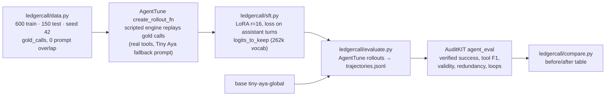

# LedgerCall

**Teaching a 3.35B open-weights model to call finance tools instead of guessing numbers.**
Cohere `tiny-aya-global` + LoRA, trained with AgentTune-rendered trajectory SFT and audited with AuditKIT on held-out multi-step finance tasks.

- **Track 3: Agentic Fine-tuning** — problem statements **Reliable tool calling** and **Efficient trajectories**
- Model: [{hf_user}/ledgercall-tiny-aya-sft](https://huggingface.co/{hf_user}/ledgercall-tiny-aya-sft) · Dataset: [{hf_user}/ledgercall-finance-toolbench](https://huggingface.co/datasets/{hf_user}/ledgercall-finance-toolbench) · Demo: [Space](https://huggingface.co/spaces/{hf_user}/ledgercall-demo) · Collection: {collection_url} · Code: {github_url}

## Headline result (100 held-out test tasks, same prompts, greedy decoding, T4)

| Metric | Direction | Base tiny-aya-global | LedgerCall (SFT LoRA) | Change |
| :--- | :---: | ---: | ---: | ---: |
{table}

AuditKIT `agent_eval` (recorded mode over AgentTune `trajectories.jsonl`) verified **{ak_base}/100 → {ak_tuned}/100** episodes as successful.

## Abstract

Small open models are attractive for finance back-office work because ledgers can stay inside a private network, but they fail in a dangerous way: they emit fluent, plausible numbers. Our baseline makes this concrete. Given four deterministic tools (`convert_currency`, `compound_interest`, `percent_change`, `loan_payment`), base Tiny Aya Global solved **{base_success_pct}** of 100 held-out tasks: {base_malformed_pct} of episodes contained a malformed or failed call (typically an invented argument name such as `annual_rate_ptc`), after which the model did the arithmetic in its head.

LedgerCall fixes this with **trajectory SFT rendered by AgentTune itself**. Because the tools are deterministic, every task has a known gold trajectory. We replay those trajectories through AgentTune's own `create_rollout_fn` with a scripted rollout engine, so each training prompt is byte-identical to what the model sees at evaluation time: the Tiny Aya chat template, AgentTune's tool fallback prompt, real tool executions and folded `Tool result for …` turns. 600 training tasks yield 1,497 assistant-turn examples; a rank-16 LoRA is trained on assistant tokens only, in {train_minutes} minutes on one free Kaggle T4. Evaluation uses AgentTune rollouts and AuditKIT `agent_eval`. Task success rises to **{tuned_success_pct}**, malformed calls fall to **{tuned_malformed_pct}**, and each task now costs **{tuned_tokens}** generated tokens instead of {base_tokens}.

## The failure, concretely (held-out task 0)

> A treasury deposit of 25310.50 USD earns 2.76% annual interest for 12 years, compounded semi-annually … compute its maturity balance, then the percentage change from a benchmark.

- **Base:** calls `compound_interest(principal=2531.5, annual_rate_ptc=2.76, …)` — wrong principal, invented argument → tool error → writes out the formula and guesses.
- **LedgerCall:** {example_tuned}

## Method



- **AgentTune** (`Lexsi-Labs/AgentTune`): rollout loop, tool execution, Tiny Aya tool-call fallback prompt and parser, trajectory serialization — used both to *render training data* and to *evaluate*. This guarantees the train/eval prompt format cannot drift.
- **AuditKIT** (`Lexsi-Labs/AuditKIT`): `agent_eval` over recorded AgentTune episodes with a custom numeric-tolerance predicate, plus `tool_call_f1_name`, `tool_call_validity`, `redundant_tool_calls`, `agent_loop_detection`.
- **Training:** LoRA r=16, alpha=32, dropout 0.05 on q/k/v/o/gate/up/down; fp16 autocast; AdamW lr 2e-4, warmup 5%, cosine; grad accumulation 8; 1 epoch ({train_steps} optimizer steps); final loss {final_loss}.
- **Eval:** greedy, max 384 new tokens/turn, max 4 tool steps, stop on `<|END_RESPONSE|>`/`<|END_OF_TURN_TOKEN|>` for **both** models (Tiny Aya's `generation_config` lists only `<EOS_TOKEN>`, which otherwise makes every turn run to the token cap). Success = starred final number within 1% of the gold answer.

## Metrics and why

- **Task success** — the outcome that matters: correct final number.
- **Ordered tool-call accuracy / exact sequence** — did it pick the right tools in the right order for 2-step compositions.
- **Malformed / failed call rate** — reliability of the call payload itself (bad names, bad keys, tool errors).
- **Avg tool calls, completion tokens, latency** — trajectory efficiency: correct answers should not cost more steps or tokens.
- **AuditKIT diagnostics** — an independent, kit-standard view of the same episodes.

## Data

`ledgercall/data.py` deterministically generates 8 task families (4 single-tool, 4 two-step compositions such as `compound_interest → convert_currency`), 600 train / 150 test, with normalized-prompt leakage check (`leak_overlap_count = 0`). Each row stores `prompt`, `answer`, `expected_tools`, `gold_calls`, `task_type`.

## What did not work (honest notes)

- **GRPO** via AgentTune `create_agentic_trainer` (`ledgercall/train.py`, rewards in `ledgercall/rewards.py`) ran out of memory on the 16 GB T4 before its first step (3.35B model, 4 generations, multi-turn rollouts). We kept the reward code; GRPO warm-started from this SFT adapter is the natural next step on a 24–40 GB GPU.
- The gated Hugging Face repo was not yet accessible from our account during the sprint, so weights were loaded from Cohere's official Kaggle Models mirror (`cohere-labs/tiny-aya/transformers/global/1`), the same checkpoint.

## Limitations

- English-only synthetic prompts; 4 tools; static FX table.
- Gold trajectories teach one canonical call style; robustness to paraphrased or adversarial prompts (e.g. injected instructions inside tool output) is not yet measured.
- 100 of 150 test tasks evaluated to fit the free GPU budget.

## With more compute

1. GRPO from the SFT adapter with `rewards.py` (correctness + tool choice + non-positive efficiency penalty) on L4/A100.
2. Multilingual task templates (Tiny Aya's strength) and 3–4 step reconciliations, plus abstention cases where no tool applies.
3. AuditKIT red-team probes for prompt injection through tool results.

## Reproduce

```bash
pip install "git+https://github.com/Lexsi-Labs/AgentTune" "auditkit[transformers]" peft datasets sentencepiece
python -m ledgercall.data --out data/
python -m pytest -q tests/
python -m ledgercall.evaluate --model <tiny-aya-global path> --data data/test.jsonl --tag base --limit 100
python -m ledgercall.sft --model <tiny-aya-global path> --train_file data/train.jsonl --output_dir out/sft
python -m ledgercall.evaluate --model out/sft --base-model <tiny-aya-global path> --data data/test.jsonl --tag tuned --limit 100
python -m ledgercall.compare --base results/base_metrics.json --tuned results/tuned_metrics.json --out results/comparison.md
```

`kaggle/run.py`-style single script used for the official run: see `scripts/kaggle_run.py`.

## Licenses

Code and synthetic data: MIT. The LoRA adapter is a derivative of `CohereLabs/tiny-aya-global` and inherits **CC BY-NC 4.0** (non-commercial). AgentTune and AuditKIT are under Lexsi Labs source-available licenses.

## Declaration

Built solo by Frank Zhu during the Lexsi AI Safety & Alignment Hackathon on Nov 15, 2026. No pre-existing project code was reused; AgentTune and AuditKIT are used as libraries.
